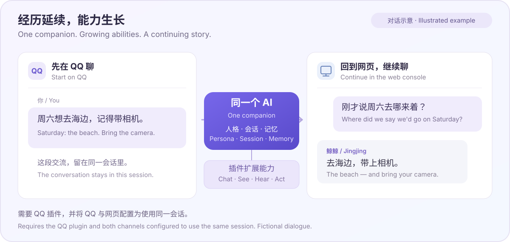
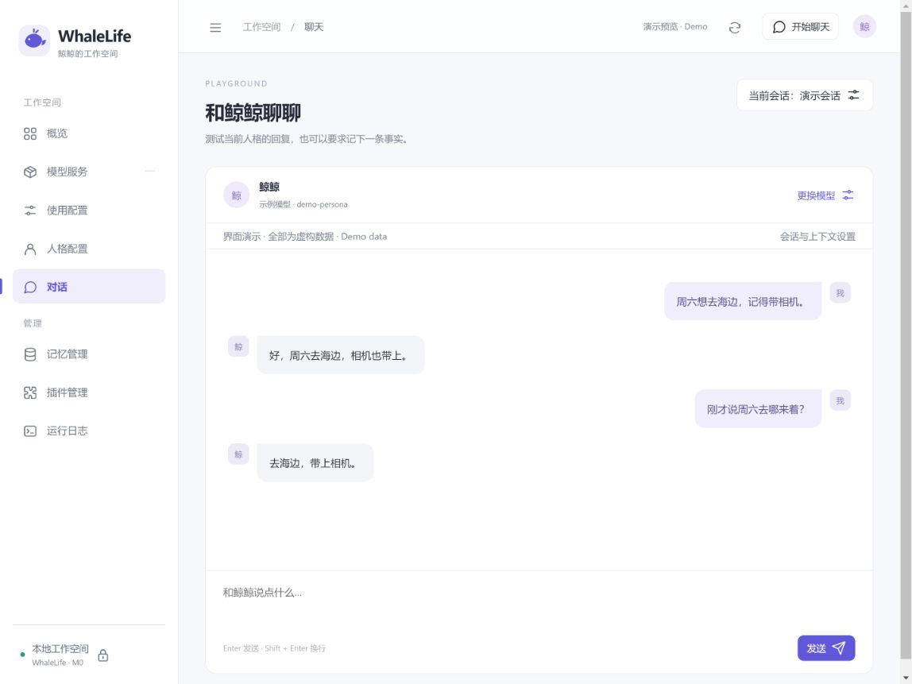

# WhaleLife

[简体中文](README.md) · **English**

**One companion. A continuous history. New capabilities.**

WhaleLife is a self-hosted AI companion framework built around continuity of self. The core maintains its persona, sessions, and memory; plugins give that companion new ways to perceive and act. The design goal is a consistent sense of the same companion as its experiences accumulate and its capabilities grow.

[Get started](#get-started) · [Explore plugins](#add-new-capabilities) · [Documentation](#documentation-and-contributing) · [Report an issue](https://github.com/iinukami/whalelife/issues)

## A conversation that carries forward



*Illustrated example with fictional dialogue. To continue a conversation across QQ and the web console, install and configure the QQ plugin and use the same session. QQ uses the persona selected in the core. Separate sessions keep their own history by default.*

Tell your companion about a book on QQ, then return to the web console and continue talking about it. With both interfaces connected to the same session, that earlier exchange remains part of the conversation. Add web browsing later, and the same companion can use it to look something up. A new plugin adds a capability around the existing persona and history.

You choose the model and edit the persona. Changing a persona keeps the current session unless you explicitly create a new one. Automatic diary summarization is off by default; you can enable it at a context-usage threshold you choose. Diary entries then replace the corresponding messages in the model's context while the original records remain available. Model context limits still apply.



*The current console uses Chinese labels. This preview contains sample data.*

## Get started

You will need **Node.js 24 or later** and access to a model service. Configure your own cloud API or local OpenAI-compatible endpoint; the model must support the chat and tool-calling features you use. Cloud providers charge according to their own pricing. Running the console locally does not make cloud model requests local.

The interface and most detailed documentation are currently in Chinese. The menu labels below match the console so you can follow along.

### Install manually

1. Download this repository, or clone it:

   ```sh
   git clone https://github.com/iinukami/whalelife.git
   cd whalelife
   npm ci
   ```

2. For a **new installation**, create a `config` directory and copy `config.example.json` to `config/config.json`. Keep your existing configuration when upgrading.
3. Start WhaleLife in a terminal:

   ```sh
   npm start
   ```

   On Windows, you can also double-click `start.bat`. Open the [local console](http://127.0.0.1:9270). Keep the terminal open while WhaleLife runs; press `Ctrl+C` to stop it.

4. Open **模型服务** (model services) and add your connection and chat model. In **使用配置** (active configuration), select the model and persona. Open **对话** (chat) to begin.

The default persona is **鲸鲸** (Jingjing). Use **人格配置** (persona settings) to edit it or create your own. Memory folders are created on first startup. Plugin requirements vary; check each plugin's documentation for supported systems and dependencies.

### Let DSH help you install

1. Download **DeepSeek Harness (DSH)** for desktop from the [DeepSeek website](https://www.deepseek.com/download/).
2. After configuring DSH, start a new chat and send:

   ```text
   Please install WhaleLife from https://github.com/iinukami/whalelife . Install only the core, without plugins. Then start it in the foreground and give me the local console URL.
   ```

### Update an existing installation

In **概览** (overview), choose **检查更新** (check for updates), review the release, then choose **更新并重启** (update and restart). Updates preserve configuration, personas, memory, and installed plugin data. Keep enough disk space for the update backup. For older installations and recovery details, see the [usage guide](architecture/USAGE.md) (Chinese).

## Add new capabilities

Open **插件商店** (plugin store) from **概览** (overview) or **插件管理** (plugin management). Review the selected version and dependencies, then confirm installation. Manage settings, updates, and enable/disable controls in the console.

| Plugin | What it adds |
| --- | --- |
| [QQ](https://github.com/iinukami/whalelife-plugin-qq) | Send and receive QQ messages using a WhaleLife session. |
| [Qzone](https://github.com/iinukami/whalelife-plugin-qzone) | Browse and interact with Qzone; requires the QQ plugin. |
| [Autonomy](https://github.com/iinukami/whalelife-plugin-autonomy) | Manage intentions and initiate actions using installed capabilities. |
| [Gallery](https://github.com/iinukami/whalelife-plugin-gallery) | Store and organize images for use by the model and other plugins. |
| [Web browsing](https://github.com/iinukami/whalelife-plugin-surf) | Search and read web pages. |
| [Bilibili](https://github.com/iinukami/whalelife-plugin-bilibili) | Browse videos and use configured interactions; requires the web browsing plugin. |
| [Audiovisual understanding](https://github.com/iinukami/whalelife-plugin-vision) | Prepare images, video frames, and audio for model understanding. |

Plugins are maintained in separate repositories and installed separately. Platform accounts, model support, and other dependencies are described in each plugin's documentation.

[Browse the plugin catalog](market/README.md) · [Open the local plugin store](http://127.0.0.1:9270/#market)

## Documentation and contributing

| Read more | Covers |
| --- | --- |
| [Usage guide](architecture/USAGE.md) | Setup, updates, and plugin management. |
| [Memory](architecture/MEMORY.md) | Conversation history, optional diaries, context limits, and usage estimates. |
| [Project status and architecture](architecture/STATUS.md) | Implemented capabilities and current limitations. |
| [Plugin contract](architecture/PLUGINS.md) | Public interfaces and compatibility requirements. |
| [Community plugin submissions](market/community-packages.md) | Packaging, review, and store inclusion. |

These detailed guides are currently in Chinese. For plugin development, start with the [plugin development rules](plugins/AGENTS.md) and public contract. For core contributions, read the [repository rules](AGENTS.md) and discuss the scope in an [issue](https://github.com/iinukami/whalelife/issues) before starting a substantial change.

Questions, bug reports, and community plugins are welcome. **QQ community group: 962935021.**
